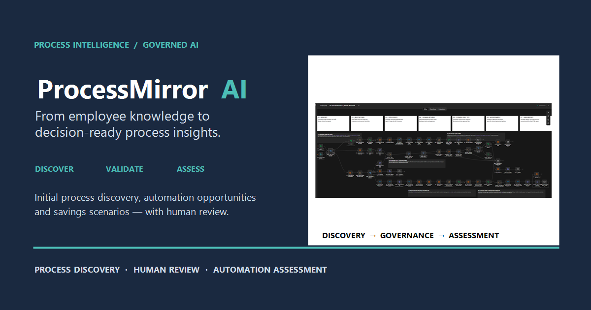

# ProcessMirror AI

**An AI-powered consulting platform that turns employee process knowledge into decision-ready process intelligence.**

[Explore the employee interview](https://daniel-prokop.github.io/ProcessMirrorAI/ProcessMirror_AI_SAVI_Interviewformular_Multiprozess.html) · [View the executive report](https://daniel-prokop.github.io/ProcessMirrorAI/ProcessMirror_AI_SAVI_Abschlussbericht_Demo-GmbH.html)



**From fragmented process knowledge to a validated automation and ROI roadmap.**

---

## Make operational knowledge visible

Most organizations do not lack data. They lack a clear picture of how work actually happens.

Process knowledge is often fragmented across departments, systems and employees. Documentation is incomplete, automation initiatives start with assumptions, and consultants must spend significant time collecting and validating information.

**ProcessMirror AI connects process discovery, validation and assessment in one governed workflow.**

Employees provide structured input. AI-supported agents create clear process documentation, maps and opportunities. Human reviewers retain control before results become the basis for executive decisions.

## From interview to improvement roadmap

1. **Capture** employee knowledge through a guided, multi-process interview.
2. **Discover** activities, roles, systems, dependencies and bottlenecks.
3. **Validate** the documented process with employees and consultants.
4. **Assess** automation opportunities and possible savings.
5. **Estimate** preliminary ROI scenarios based on documented evidence.
6. **Report** findings in a clear executive-ready format.

---

## Why it matters

| For executives | For consultants | For AI-focused teams |
|---|---|---|
| Gain a shared, evidence-based view of current operations and improvement priorities. | Accelerate process discovery while keeping employee knowledge and expert judgment at the center. | Demonstrate governed, multi-agent workflows that combine AI with human review and privacy-aware processing. |

---

## See the platform

### Employee interview

The interactive interview gives employees a structured way to document responsibilities, systems, bottlenecks and improvement ideas across multiple processes.

[Open the live interview demo](https://daniel-prokop.github.io/ProcessMirrorAI/ProcessMirror_AI_SAVI_Interviewformular_Multiprozess.html)


### Executive assessment

The assessment view transforms validated process information into a consultant-style report for decision-makers. It brings process documentation, technology mapping and automation potential together in one coherent story.

[Open the live report demo](https://daniel-prokop.github.io/ProcessMirrorAI/ProcessMirror_AI_SAVI_Abschlussbericht_Demo-GmbH.html)


Both demos are available in German, reflecting the platform's focus on German organizations and business consulting environments.

---

## What ProcessMirror AI delivers

- **Process documentation** with roles, activities, inputs, outputs and dependencies
- **Visual process flows** that make operational complexity easier to understand
- **Tool and system mapping** across the current process landscape
- **Automation opportunity assessment** for repetitive and manual work
- **Savings scenarios** based on potential time and effort reductions
- **Initial ROI estimates** with clearly preliminary assumptions
- **Executive reports** that translate operational detail into actionable priorities

## Designed for trustworthy decisions

ProcessMirror AI follows a human-in-the-loop approach:

```text
Understand  →  Document  →  Validate  →  Assess  →  Prioritize
```

- Employees validate process information.
- Consultants approve documentation and assessment steps.
- Findings remain traceable to the reviewed process evidence.
- AI supports analysis; people retain decision authority.
- Deterministic workflows provide governance around AI-assisted work.

## Privacy-aware processing

ProcessMirror AI includes privacy-focused guardrails within its n8n workflow. Personally identifiable information and secret keys are detected and filtered before pseudonymized data is sent to an LLM. Mapping data is then controlled by n8n to restore business context in downstream results.

This is an implemented processing pattern, not a claim of certification or absolute privacy.

---

## Platform architecture

The platform combines a central orchestrator with specialized AI agents.

```text
┌─────────────────────────────────────────────┐
│ 00 MASTER ORCHESTRATOR                      │
│ Campaigns · Governance · Reporting          │
└─────────────────┬───────────────────────────┘
                  │
                  ▼
┌─────────────────────────────────────────────┐
│ 01 DISCOVERY AGENT                          │
│ Process Discovery · Gap Detection           │
│ Diagram and Documentation Generation        │
└─────────────────┬───────────────────────────┘
                  │
                  ▼
┌─────────────────────────────────────────────┐
│ 02 ASSESSMENT AGENT                         │
│ Tool Mapping · Automation Assessment        │
│ Savings and Initial ROI Scenarios           │
└─────────────────────────────────────────────┘
```

### Master Orchestrator

Coordinates campaigns, employee participation, approvals, governance, workflow execution and report delivery.


### Discovery Agent

Transforms employee knowledge into structured, reviewable process intelligence. It identifies activities, roles, systems, dependencies and gaps while producing process documentation and visual diagrams.


### Assessment Agent

Evaluates approved process knowledge to identify repetitive work, integration opportunities, automation potential and realistic savings scenarios.


---

## Technology

- n8n workflow orchestration
- Multi-agent AI architecture
- Human-in-the-loop governance
- Privacy-aware pseudonymization
- Process and tool mapping
- Automation and ROI assessment
- Mermaid process visualization
- HTML-based executive reporting

## Project vision

ProcessMirror AI bridges employee knowledge, process consulting and intelligent automation.

By combining governed workflows, specialized AI agents and human validation, it helps organizations turn operational knowledge into a transparent and actionable automation roadmap.
